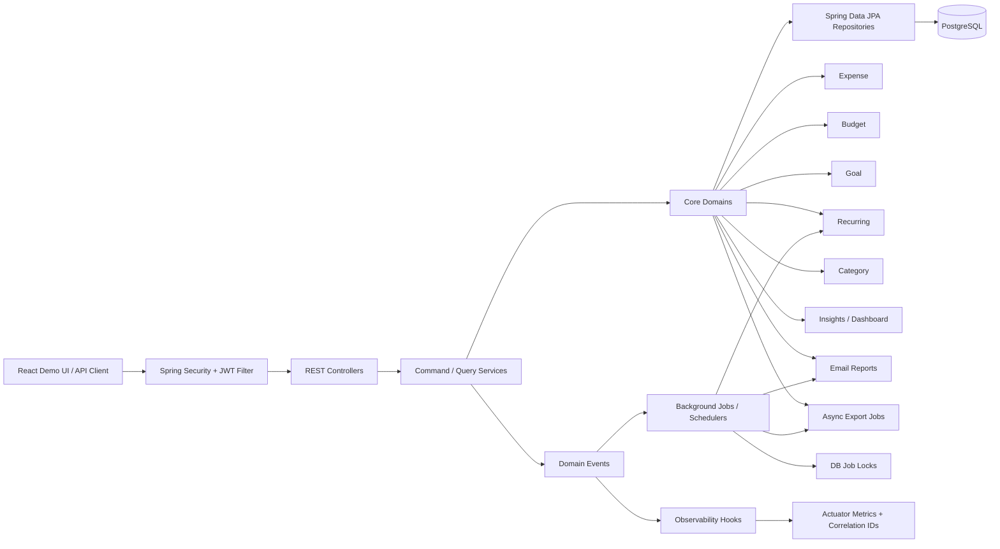

# Expense Tracker

Backend-first personal finance platform built with **Java 21**, **Spring Boot 4**, **Spring Security**, and **PostgreSQL**.

This project started as an expense manager and evolved into a more production-minded backend system with authentication, budgeting, goals, recurring automation, async exports, scheduled jobs, observability, and strong test coverage. The frontend exists for demo purposes, but the primary focus of this project is backend architecture and API design.

## Why This Project Stands Out

This is not just CRUD around an `expense` table. The backend includes:

- JWT-based authentication and protected APIs
- Modular domain packages for expenses, budgets, goals, recurring automation, exports, email, and insights
- Command/query service separation for core financial flows
- Event-driven extension points for expense, budget, and goal changes
- Background job design with idempotency and DB-backed job locking
- Async export jobs with downloadable CSV/PDF artifacts
- Scheduled recurring expense generation and monthly email reports
- Rate limiting for auth and other high-cost actions
- Request correlation IDs, structured logging, and actuator metrics
- Integration + unit tests using JUnit, MockMvc, H2, and Mockito

## Backend Architecture

The backend follows a modular monolith approach. Instead of one flat package with controllers and services mixed together, the code is organized by business capability.



### Major modules

- `auth`: registration, login, JWT issuance
- `expense`: expense CRUD, filtering, search, pagination, query/command split, domain events
- `category`: predefined + user-managed categories
- `budget`: monthly budget tracking, alert thresholds, budget summaries
- `goals`: savings goals with progress/status calculations
- `recurring`: recurring expense rules and scheduled generation
- `smartcategory`: keyword-driven category mapping
- `dashboard`: monthly summary, trends, category breakdown
- `insights`: backend-generated spending insights
- `export`: sync generation helpers plus async export jobs and downloads
- `email`: email preference management and scheduled monthly summaries
- `job`: DB-backed scheduler lock protection
- `observability`: correlation IDs and metrics hooks
- `common`: shared DTOs, base entities, exceptions

### Design choices

- **Command/query separation** for expenses, budgets, and goals keeps read concerns away from write flows.
- **Domain events** provide lightweight extension points without adding message brokers.
- **Background jobs** are hardened with duplicate-run protection and idempotency rules.
- **DTO-first APIs** prevent direct entity exposure.
- **Global exception handling** keeps API responses consistent.
- **Rate limiting** protects auth and expensive operations from abuse.

## Core Features

### Authentication and Security

- Register and login APIs
- JWT authentication
- User-scoped access control
- Validation-driven request handling
- Rate limiting on login and registration

### Expense Management

- Create, update, delete, and fetch expenses
- Pagination, sorting, filtering, and search
- Category and date-range filters
- Amount-range filters
- Smart category auto-mapping from keyword rules

### Financial Planning

- Monthly budgets with spent / remaining / usage percentage
- Threshold-based budget alerts
- Budget history
- Savings goals with progress calculations and statuses

### Automation and Reporting

- Recurring expense rules
- Scheduled recurring generation
- Email report preferences and monthly report scheduling
- CSV and PDF exports
- Async export jobs with polling + download endpoints

### Insights and Dashboard

- Dashboard summary endpoints
- Category breakdown and monthly trends
- Spending insights comparing current vs previous month
- Largest expense / top category summaries

## Technical Highlights

### Background job safety

The project intentionally treats recurring generation, export processing, and scheduled email reporting as backend jobs instead of normal controller logic.

Implemented safeguards:

- DB-level idempotency for generated recurring expenses
- Job lock table for duplicate-run protection
- Async export queue backed by persistent job entities
- Scheduled polling for queued export work

### Observability

Implemented practical observability instead of overengineering:

- Request correlation IDs
- Structured request logs
- Metrics for auth, exports, recurring jobs, and email sends
- Spring Boot Actuator endpoints

### Testing strategy

The backend includes both integration and unit tests.

**Integration coverage**
- auth and security flows
- expense/category APIs
- budgets and goals
- recurring, insights, export, and email features
- validation and edge cases

**Unit coverage**
- budget service
- insights service
- email report service
- command-side event publishing services

## Tech Stack

### Backend

- Java 21
- Spring Boot 4
- Spring Security
- Spring Data JPA
- Hibernate
- PostgreSQL
- JJWT
- OpenPDF
- Spring Mail
- Spring Boot Actuator
- Springdoc OpenAPI / Swagger UI

### Testing

- JUnit 5
- Mockito
- MockMvc
- H2
- Spring Security Test

### Frontend

- React
- Vite
- Node's built-in test runner (`npm test`)

## API Documentation

OpenAPI docs are available when the backend is running:

- Swagger UI: `http://localhost:9090/api/swagger-ui.html`
- OpenAPI JSON: `http://localhost:9090/api/v3/api-docs`

## Read-Only AI Assistant

`expense-ai/` is a separate FastAPI + LangGraph service that answers questions about
a user's own financial data. It is read-only by construction: it registers no write
tools, holds no credentials for the financial schema, and reaches data solely
through the Spring Boot API using the caller's own token. A question that cannot be
grounded in retrieved data is refused rather than answered from imagination.

- Streaming: `POST /api/v1/chat` responds with typed server-sent events
  (`message_start`, `status`, `token`, `message_complete`, `error`).
- Memory: `GET|DELETE /api/v1/conversations` stores the assistant's own history in
  its own PostgreSQL database.
- Observability: in-process metrics exposed as Prometheus text at `/metrics`
  (opt-in) and optional LangSmith tracing (off by default, and never the
  production path).

`expense-ai/README.md` covers the service, `expense-ai/docs/observability.md` the
signals and cost counters, and `expense-ai/docs/operations.md` retention, deletion
and incident procedures.

### Chat UI

The React app in `frontend/` adds an **Assistant** section: streamed answers,
conversation history, progress states, cancellation, and inline errors. Existing
screens are unchanged.

```bash
# terminal 1 — Spring Boot API on http://localhost:9090
mvn spring-boot:run

# terminal 2 — assistant on http://localhost:8080
cd expense-ai && uv run uvicorn app.main:app --reload

# terminal 3 — frontend on http://localhost:5173
cd frontend && npm install && npm run dev
```

Vite proxies `/api` to Spring Boot and `/ai` to the assistant (`VITE_AI_ORIGIN`
overrides the latter), so the browser keeps working against a single origin.

## Staging Deployment

`compose.staging.yaml` runs the whole stack — Spring Boot, the assistant, one
PostgreSQL per service, and the SPA behind nginx:

```bash
cp .env.staging.example .env.staging   # fill in the values marked REQUIRED
docker compose -f compose.staging.yaml --env-file .env.staging up --build
```

Verification steps, TLS, secret handling, monitoring and rollback are in
`docs/deployment.md`.
